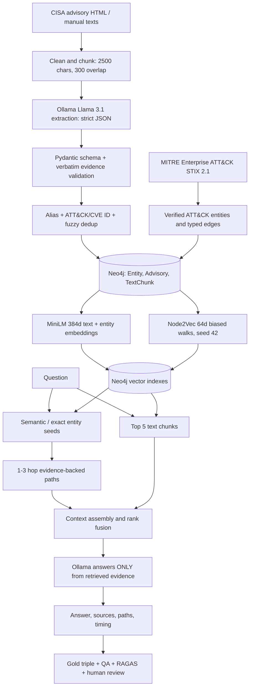

# System Architecture and Component Interfaces

## Ontology

Allowed typed edges (all require provenance):

- `ThreatGroup USES Malware | Technique`
- `Campaign USES Malware | Technique`
- `Malware IMPLEMENTS Technique`
- `ThreatGroup | Campaign | Malware EXPLOITS Vulnerability` (for group-EXPLOITS, supported by schema extension for explicit source text)
- `ThreatGroup | Campaign TARGETS Target`
- `Technique | Vulnerability MITIGATED_BY Mitigation`
- `Campaign ATTRIBUTED_TO ThreatGroup`
- `Entity DESCRIBED_IN Advisory`, `TextChunk PART_OF Advisory`

`Entity` is a shared label; typed labels retain the ontology class. ATT&CK/STIX relations use an explicit `MITRE_STIX_VERIFIED` source kind, separated from CISA extraction records. All graphs are limited to three hops during retrieval.

## Data model boundaries

**Extraction JSON**: `entities: [{id,name,entity_type,aliases,attack_id,cve_id,description,confidence_score}]`, `relations: [{source_id,target_id,predicate,evidence_text,confidence_score}]`.

**Graph record**: canonical Entity ID, names, aliases, official IDs, schema type, attributes, provenance-bearing relationships.

**Retrieval**: `text_chunks`, `seed_entities`, `graph_paths`, `node2vec_related`, `retrieval_scores`, `retrieval_time_ms`.

**Answer**: `question`, `mode`, `answer`, `sources`, `retrieved_doc_ids`, `retrieved_entity_ids`, `graph_paths`, `contexts`, `retrieval_time_ms`, `generation_time_ms`.

## Distinction between embeddings

MiniLM query vectors are 384d, for semantic text retrieval into 384d TextChunk and Entity index. Node2Vec 64d vectors express graph proximity and **can only be queried using 64d graph-node vectors**, not with the question's 384d semantic embedding. The implementation intentionally uses exact/semantic question matches to select graph seeds before Node2Vec structural neighbor lookup.

## Benchmark comparison

Each verified question is posed to both the text-only mode and hybrid mode using identical text chunks and answer LLM. The only additional input is GraphRAG graph retrieval. Paired output logs support answer factuality, completeness, coherence, source grounding, required-entity/path hit rate and time comparisons. Official RAGAS is optional; local-judge metrics are labeled separately.
